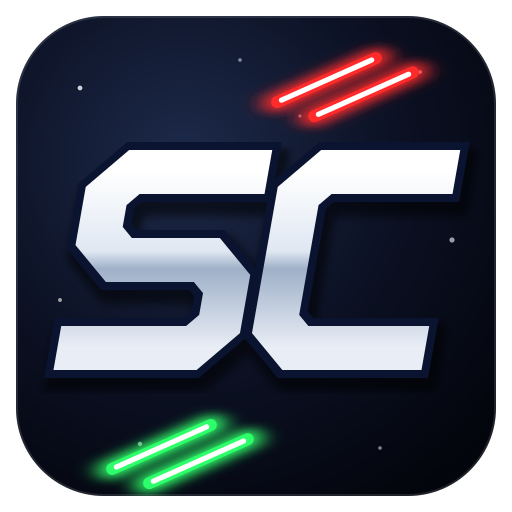

# Starfighter Companion

Made by Rasi.

A small, standalone pilot file editor for the Star Wars X-Wing series.
Open a pilot, change anything the game stores about it, and save — without being able to put the pilot
into a state that the game cannot handle.

| Game | File | Notes |
|---|---|---|
| X-Wing (1993 floppy, 1994 CD-ROM, 1998 Windows, GOG/Steam) | `.plt` | DOS and Windows layouts are told apart by size |
| TIE Fighter (1994 floppy, 1995 CD-ROM, 1998 Windows, GOG/Steam) | `.tfr` | current + backup record are kept in step |
| X-Wing vs. TIE Fighter | `.plt` | |
| Balance of Power | `.pl2` | BoP also keeps an XvT `.plt` next to it |
| X-Wing Alliance, XWA Upgrade 2025 and 2020, Embers of the Empire, TIE Fighter Total Conversion Classic and Reimagined | `.plt` | craft names and mission lists of each version are built in |
| OpenXW, OpenTIE, OpenXvT, OpenXWA | as the original games | they read and write the original formats |
| XWVM | `.vmpilot` | XML; unknown content is preserved |

## Download and run

Grab the file for your system from the [Releases](../../releases) page. There is nothing to install:
the .NET runtime is built into the program.

* **Windows:** `StarfighterCompanion-win-x64.exe`
* **Linux / Steam Deck (desktop mode):** `StarfighterCompanion-linux-x64` — make it executable (`chmod +x`) and run it.
* **macOS:** `StarfighterCompanion-osx-arm64.zip` (Apple Silicon) or `-osx-x64.zip` (Intel). The app is not signed, so the first time
  right-click it and choose **Open**.

Close the game before editing its pilots — most of them write the pilot file when they exit.

## Using it

The left side is a game menu: pick a game, then a version (X-Wing 1993 / 1994 / 1998, TIE Fighter 1994 / 1995 / 1998,
Balance of Power, XWA Upgrade, TFTC, OpenXW…),
and the pilots in that version's folder are listed. Click one to edit it; **Back to game menu** takes you back.

Installed games are found automatically:

* **From XWVM's own settings** — the X-Wing and TIE Fighter folders you gave XWVM (`gameVariantConfigurations` in its
  config in `%APPDATA%\XWVM`).
* **XWVM pilots** — XWVM's pilot folder, `%APPDATA%\XWVM\pilots` (`~/.config/XWVM/pilots` on Linux/macOS).
* **Steam libraries, GOG (registry and default folders), Heroic, common game folders and classic CD installs.**
  Inside an install, each edition is told apart by its files, using the same markers as XWVM's resource finders
  (for example `XWING95.EXE` + `X-Wing Data` for X-Wing 1998, `BWING.EXE` for the 1994 CD-ROM, `XWING.EXE` +
  `FLIGHT.OVL` for the 1993 floppy; `TIE95.EXE` for TIE Fighter 1998, `Z_TIE__.EXE` for the 1995 CD-ROM).
* **OpenXW, OpenTIE, OpenXvT, OpenXWA** — their user folders (`TotallyOpen/<App>` in the SDL preference path). Anything that is not found, or found in the wrong
place, can be set in **Settings**, which lists every game and version with **Browse…**, **Automatic** and **None** buttons.
Settings are stored in your user settings folder (`%APPDATA%\StarfighterCompanion` on Windows,
`~/.config/StarfighterCompanion` on Linux and macOS).

### Converting between editions, XWVM and TFTC

**Convert / export…** (top right of the editor, or the File menu) writes the open pilot as a new file for another
version; the open file itself is not changed.

* **X-Wing 1993 ⇄ 1994 ⇄ 1998** and **TIE Fighter 1994 ⇄ 1995 ⇄ 1998.** The editions store nearly the same record
  (X-Wing's DOS record has one extra reserved byte), so nothing is lost. What differs is the content: the 1993 X-Wing
  floppy needs the Imperial Pursuit and B-Wing add-ons for tours 4 and 5, and the 1994 TIE Fighter floppy has battles
  1–7 (8–10 with Defender of the Empire) — you are warned about these, and a current battle the floppy does not have
  is moved to one it has.
* **Into XWVM.** An X-Wing or TIE Fighter pilot becomes a new XWVM pilot, or replaces that game's career of an XWVM
  pilot with the same name (its other games, droid and avatar are kept). X-Wing follows XWVM's own pilot import.
* **Out of XWVM.** The X-Wing or TIE Fighter career of an XWVM pilot is written as a pilot file for any edition.
  XWVM does not record which of two alternative missions was flown, so such scores go to the first one, and
  craft the old game has no slot for are left out (you are told how many).
* **TIE Fighter ⇄ TIE Fighter Total Conversion Classic ⇄ XWVM.** TFTC Classic has TIE Fighter's battles and Combat
  Chamber missions one for one, so battle progress, mission scores, Combat Chamber missions, kills by craft and weapon
  statistics move across. TFTC has no place for TIE Fighter's rank, Secret Order, secret and bonus objectives or
  training simulator levels. A TFTC pilot holds much more than TIE Fighter knows about, so a career is written *into
  an existing TFTC pilot* (create it in TFTC first); its pilot training, rating, awards and the rest are kept. Open TFTC
  pilots from the TFTC Classic version in the game menu to convert them.

The new file goes into that version's folder from Settings (or one you pick), named after the pilot. The DOS editions
allow 8 characters, the 1998 editions 16. If the file exists, it is replaced and backed up as usual.

### Icons and X-Wing pilot portraits

Each game and version in the menu shows its icon, read from the game's own folder (its program, or the `.ico` file
GOG installs). Nothing copyrighted is shipped with Starfighter Companion: a game that is not installed, or a version
without an icon of its own (the DOS editions), shows a red question mark instead.

DOS X-Wing gave every pilot a face on its pilot selection screen, chosen from the pilot's name. X-Wing pilots get the
same face in the editor, read from your DOS X-Wing install (`RESOURCE\PILOT.LFD`, or inside the GOG/Steam CD image).
Type a new name in **Pilot name** and the face changes as you type; **Rename** renames the pilot (X-Wing keeps the
name only as the file name). The Convert dialog shows the face for the new name too.

You can still open any pilot file directly with **Open a pilot file…** or by dragging it onto the window.

## How it keeps your pilot safe

* **Only known layouts are opened.** A file is recognised by its extension and exact size (or, for XWVM, its XML root).
  Anything else is refused instead of being guessed at.
* **Every value has limits.** Numbers are limited to what the game allows (rank 0–5, difficulty Easy/Medium/Hard, …),
  choices are drop-downs, flags are check boxes, and names are limited to plain ASCII that fits the game's buffer.
  An illegal value is refused as you type and never reaches the file.
* **Values that depend on each other are checked.** For example, only one X-Wing tour may be active and it must be
  the current tour; an XWVM pilot's active tour must exist. Problems that would break the game are **errors**
  and block saving; things that are merely unusual are **warnings**.
  Problems that were already in the file are reported as warnings, so an untouched pilot can always be saved again.
* **Unknown bytes are never touched.** Saving a file without edits writes it back byte for byte.
* **Backups.** The first time a file is overwritten, the original is kept as `name.ext.original.bak` (never replaced),
  and every save keeps the previous version as `name.ext.bak`. Files are written to a temporary file first and then
  swapped in, so a crash cannot leave half a pilot behind.

## Building

Requires the [.NET 8 SDK](https://dotnet.microsoft.com/download).

```sh
dotnet test                                   # run the tests
dotnet run --project src/StarfighterCompanion # run the editor

# single-file, self-contained builds
dotnet publish src/StarfighterCompanion -c Release -r win-x64   -o publish/win-x64
dotnet publish src/StarfighterCompanion -c Release -r linux-x64 -o publish/linux-x64
dotnet publish src/StarfighterCompanion -c Release -r osx-arm64 -o publish/osx-arm64
```

Pushing a tag such as `v1.0.0` makes GitHub Actions build all platforms and attach them to a release.

### Project layout

* `src/StarfighterCompanion.Core` — file formats, validation rules, game library. No UI code; this is where the knowledge lives.
  * `Library/` — the list of games and versions, automatic install detection, pilot scanning and settings.
  * `Binary/` — a small layout engine: each binary format is described field by field, and the build fails if
    a single byte is unaccounted for.
  * `Formats/<Game>/` — one file per game with its layout, value limits and rules.
* `src/StarfighterCompanion` — the desktop app (Avalonia).
* `tests/` — unit tests. Put real pilot files in `tests/samples/` (any sub-folder) and the tests will check that
  each one opens and is saved back unchanged.

See [docs/FORMATS.md](docs/FORMATS.md) for the details of each format.

## Credits

File layouts are based on the reverse-engineering work of the **OpenXW, OpenTIE, OpenXvT and OpenXWA** projects
(GPL-3.0), their **Landru** resource library (GPL-3.0; LFD, ANIM and palette formats for the X-Wing portraits) and on **XWVM**'s pilot code.

## License

[GNU Affero General Public License v3.0](LICENSE).

Star Wars, X-Wing, TIE Fighter and related names are trademarks of Lucasfilm Ltd.
This project is not affiliated with or endorsed by Lucasfilm, Disney, LucasArts or Totally Games.
You need your own copy of the games.
